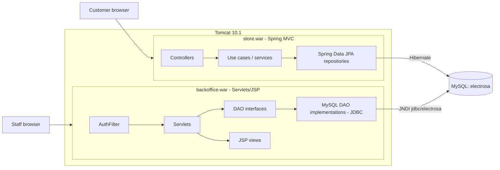

# Electrosa

A two-part web application for a fictional home-appliance retailer: a Spring MVC + JPA storefront for customers and a Servlet/JSP back office for staff, both running on Tomcat over a shared MySQL database.

## Overview

Electrosa models the day-to-day of an online appliance store. Customers browse a filterable catalogue, keep a persistent shopping cart, place orders with a delivery address and date, and can cancel orders that have not been shipped yet. Staff use a separate back office to browse the catalogue, edit articles and their images, and review customers, orders and warehouses.

The two applications deliberately use different stacks. The back office is built on plain Jakarta Servlets, JSP/JSTL and hand-written JDBC DAOs. The storefront uses Spring MVC, Spring Data JPA/Hibernate and Thymeleaf. Together they show the same domain implemented at two levels of abstraction.

The project grew over five consecutive assignments. Their commit history has been merged into this repository in chronological order, and each commit message is prefixed with its assignment (`[P2]` to `[P7]`). The user interface is in Spanish, and part of the storefront is also translated into English.

Built for the Web Application Programming course at the University of La Rioja (2025-2026).

## Features

**Storefront (`frontoffice/`)**

- Catalogue with optional filters by manufacturer, product type and price range, paginated 15 items per page, plus an article detail page.
- Customer sign-up and login. On sign-up, the missing profile fields are filled with mock data (JavaFaker). The app also guesses the customer's gender from their first name using the genderize.io API, stores a Gravatar hash and assigns starting loyalty points.
- Shopping cart persisted in the database, loaded into the session at login, with an "empty cart" action.
- Checkout with delivery address and desired delivery date, using Post/Redirect/Get with flash messages.
- Order history and order detail, with 403/404 handling when an order belongs to another customer or does not exist.
- Cancellation of unshipped orders. In a single transaction, the order is moved to the cancelled-orders tables. The customer can then list cancelled orders and view their totals.
- Avatar upload (multipart, 5 MB limit).
- Spanish/English internationalisation via `?lang=` and a language preferences page.
- Authentication filter that remembers the requested URL and returns to it after login.
- Static blog and team pages.

**Back office (`backoffice/`)**

- Administrator login: SHA-1 password check plus an administrator role check, with an authentication filter that protects every route and redirects back after login.
- Paginated catalogue with a reusable page-number pagination class.
- Article detail, article editing (type and manufacturer pickers) and article image upload.
- Customer list and customer detail, order list and warehouse list.
- Custom error pages for 404, 500 and application exceptions.

## Tech stack

| Area | Storefront | Back office |
|---|---|---|
| Language | Java 17 | Java 17 |
| Web | Spring MVC 6.2 (no Spring Boot, Java config via `WebApplicationInitializer`) | Jakarta Servlet 6, JSP + JSTL 3 |
| Views | Thymeleaf 3.1 + Layout Dialect | JSP with shared partials |
| Persistence | Spring Data JPA 3.4, Hibernate 6.6 | JDBC with DAO interfaces and MySQL implementations |
| Database | MySQL 8 via JNDI `DataSource`, schema changes with Liquibase | MySQL 8 via JNDI `DataSource` |
| Testing | none | JUnit 5, HSQLDB in-memory database |
| Other | JavaFaker, Jakarta Mail (Angus), Gson, Logback | Logback |
| Build / runtime | Maven, WAR on Tomcat 10.1 | Maven, WAR on Tomcat 10.1 |

## Architecture



Key points:

- **Storefront layering.** Controllers stay thin. Business operations live in explicit use cases (`CestaCompraUseCase`, `AnularPedidoUseCase`, `RegistroClienteUseCase`, `AvatarClienteChangeUseCase`) that take a request object and return a response object. The transactional operations (cart checkout, order cancellation) are confined to these use cases.
- **Dynamic filtering without extra code.** A single JPQL query (`ArticuloRepository.findWithFilters`) uses `:param IS NULL OR ...` clauses, so any combination of filters works with Spring Data's `Pageable`.
- **Exception-to-view mapping.** `SimpleMappingExceptionResolver` maps domain exceptions to error views and HTTP status codes (403, 404, 500).
- **Back office persistence.** The servlets depend only on DAO interfaces. The MySQL implementations obtain connections from the container's JNDI `DataSource`, and the HSQLDB-based tests reuse the same DAO code against an in-memory database.
- **Schema evolution.** The storefront ships a Liquibase changelog (`frontoffice/src/main/resources/dbchangelog.xml`) that adapts the course-provided schema. For example, it widens `pedido.CODIGOCLIENTE` so that orders from newly registered customers, who get 53-character UUIDs, can be stored.

## Getting started

### Requirements

- JDK 17 or newer. The builds below were verified with JDK 25 and Maven 3.9.14.
- Maven 3.9.
- Apache Tomcat 10.1, with the MySQL JDBC driver (`mysql-connector-j` 8.x) copied into `$CATALINA_HOME/lib/`. Both applications declare the `jdbc/electrosa` JNDI resource in their `META-INF/context.xml`, and Tomcat loads that driver from its own `lib/` folder.
- MySQL 8 on `localhost:3306` with a database named `electrosa`, reachable with user `root` and password `root`. These are the credentials hard-coded in `META-INF/context.xml`, `frontoffice/src/main/resources/liquibase.properties` and `backoffice/.../db/GestorBD.java`.

**The database is not included.** Its schema and sample data were provided by the course and are not distributed in this repository. Without them, any page that reads from the database returns an error.

### Build

From the repository root:

```bash
# Storefront -> frontoffice/target/store.war
cd frontoffice
mvn package
cd ..

# Back office -> backoffice/target/backoffice-1.0-SNAPSHOT.war
# (-DskipTests because two of its tests need a running MySQL instance)
cd backoffice
mvn package -DskipTests
cd ..
```

### Deploy

```bash
cp frontoffice/target/store.war                   "$CATALINA_HOME/webapps/store.war"
cp backoffice/target/backoffice-1.0-SNAPSHOT.war  "$CATALINA_HOME/webapps/backoffice.war"
"$CATALINA_HOME/bin/startup.sh"    # bin\startup.bat on Windows
```

- Storefront: <http://localhost:8080/store/>
- Back office: <http://localhost:8080/backoffice/>

Deploy the back office as `backoffice.war`: several of its links and redirects assume the `/backoffice` context path.

With the course database loaded, apply the storefront's schema changes once, from `frontoffice/`:

```bash
mvn liquibase:update
```

### Tests

The back office tests that run on the in-memory HSQLDB database need no setup. Run them from `backoffice/`:

```bash
mvn test -Dtest='ArticuloDaoMySQLTest,CatalogoDaoMySQLTest,PageNumberPaginationTest'
```

`mvn test` without the filter also runs `GestorBDTest` and `AlmacenDaoMySQLTest`, which connect to the local MySQL database. The storefront has no automated tests.


## What I learned

- How the same features look at two levels of abstraction: servlets, JSP and hand-written JDBC DAOs versus Spring MVC, Spring Data JPA and Thymeleaf. I also learned what each layer of the framework stack takes off your hands.
- Structuring business operations as use cases with explicit request/response objects and transactional boundaries. One example is moving an order and its lines to the cancelled-orders tables atomically.
- Web flow patterns such as Post/Redirect/Get with flash attributes, and authentication filters that send the user back to the page they originally requested.
- Evolving an existing schema with Liquibase changesets. One case was tracking down a `Data too long` error caused by a `varchar(10)` foreign key receiving 53-character UUIDs.

## Credits

- The project builds on base code and resources provided in the course, including the Electrosa brand and logo, the database schema and data, page templates, and product images and names.
- UI components inspired by [Uiverse.io](https://uiverse.io): input by dovatgabriel ([mean-stingray-9](https://uiverse.io/dovatgabriel/mean-stingray-9)) and button by abrahamcalsin ([sour-donkey-65](https://uiverse.io/abrahamcalsin/sour-donkey-65)).
- Photos from [Unsplash](https://unsplash.com) by Murat Demircan, Mikhail Vasilyev, PlanetCare, Jason Briscoe and Kam Idris. Photo by Latrach Med Jamil (`latrach-med-jamil.jpg`).
- Illustration "Group of friends with electronic devices" from [Freepik](https://www.freepik.com).
- Team photo from [Pexels](https://www.pexels.com) (`olly-3767411.jpg`).
- Form icons (`cd-icon-*`) from [CodyHouse](https://codyhouse.co). Icons from [Ionicons](https://ionic.io/ionicons). Fonts Poppins, Urbanist and Space Mono from [Google Fonts](https://fonts.google.com).
- Libraries: Spring Framework, Spring Data JPA, Hibernate ORM, Thymeleaf and Thymeleaf Layout Dialect, Liquibase, JavaFaker, Gson, Jakarta Mail (Eclipse Angus), Logback, jQuery, Modernizr, JUnit 5 and HSQLDB.

## License

The source code is released under the [MIT License](LICENSE). Third-party images, icons and other assets listed in Credits remain under their respective licenses.
